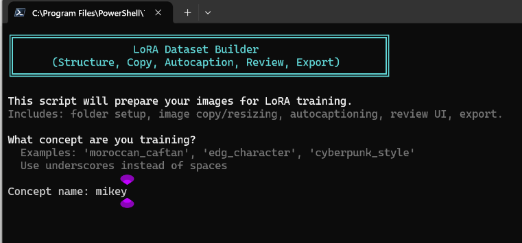
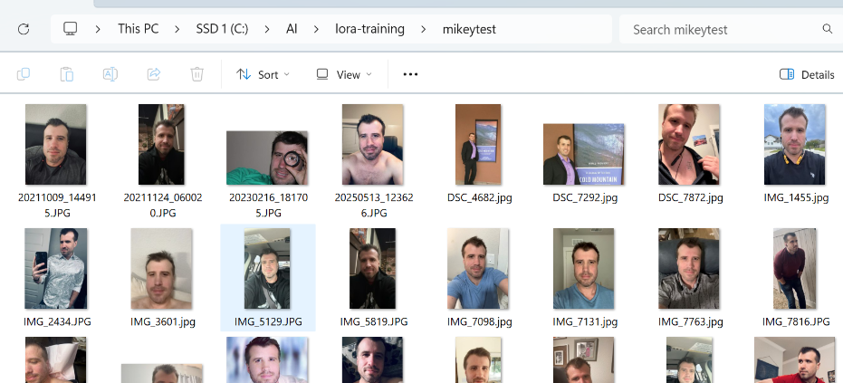
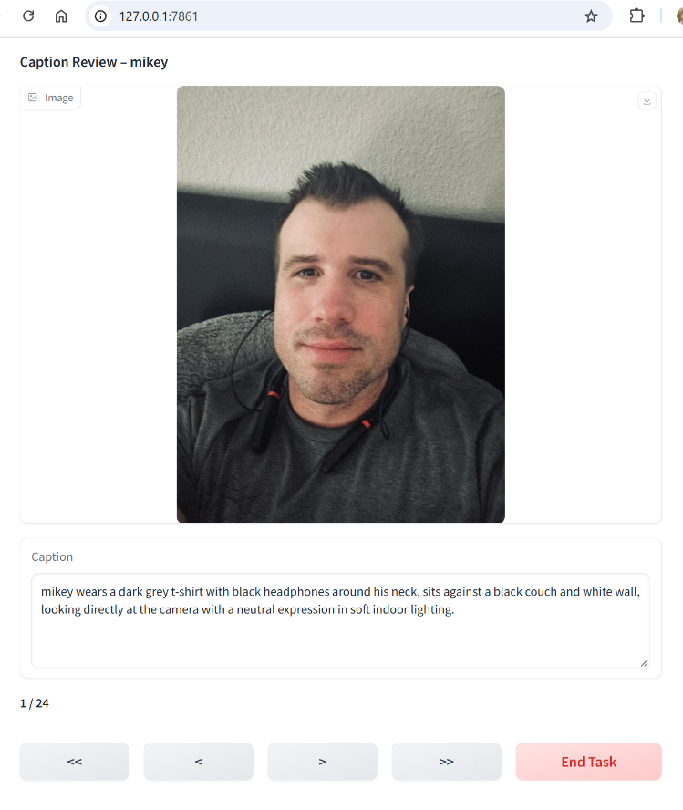
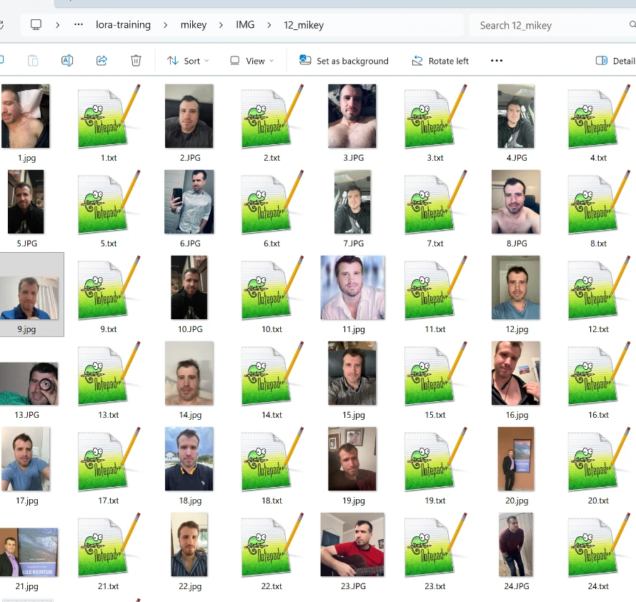

# LoRA Dataset Builder

Local, GPU-accelerated tooling that turns a folder of raw photos into a captioned,
reviewed, training-ready LoRA dataset on Windows.

Captioning runs behind a pluggable provider interface, so the pipeline is not tied
to one vision model. Everything runs locally: no images or captions leave the machine.

```
source images (read-only)
      |  copy
      v
 dataset folder  ->  caption  ->  review & edit  ->  export  ->  kohya_ss
                        |              |                |
                 captions.json   captions.csv      <image>.txt
```

Source images are never written to. They are copied into a dataset folder and
captioned there, so a run can always be repeated from the untouched originals.

## What it does

### 1. Name the concept



A **concept** is the thing you are teaching the model, and its name becomes the
**trigger word**: the token you put in a prompt later to summon it. Train on
`mikey` and you prompt `mikey, standing in a kitchen, soft window light`.

Pick something short and distinctive that the base model does not already
associate with something else. `mikey` or `rf1` work; `red fox` does not,
because the model already has strong ideas about both words and will drag them
in. The trigger must also be spelled identically in every caption, which this
tool enforces for you. For a fuller treatment, see
[this guide to choosing a trigger word](https://offlinecreator.com/guide/lora-trigger-word-guide).

### 2. Point it at a folder of photos



Any ordinary folder of images, straight off a phone or camera. Mixed filenames,
mixed sizes and mixed orientations are all fine. **This folder is only ever read
from** - nothing is written back into it.

### 3. Review the captions



Captions are generated, not guaranteed. A vision model will occasionally invent
a detail that is not in the photo, and a confidently wrong caption teaches the
model something false about your concept - the failure mode that degrades a
dataset fastest.

So the wizard opens a browser UI and steps you through every image with its
caption in an editable box. Every navigation action saves, so there is no
unsaved state to lose. Click **End Task** when you are done and the pipeline
continues on its own.

This step is where a dataset goes from automatic to actually good, and it is
worth the few minutes. [What to look for](docs/DECISIONS.md#9-review-ui) when
reviewing.

### 4. Get a training-ready dataset



Every image has been copied out, optionally **resized** to a sensible maximum
edge, **renamed** to a clean sequence, and paired with a **`.txt` file holding
its caption**. That image/text pairing is the format kohya_ss and most other
trainers expect: each `1.jpg` is read alongside `1.txt`.

The folder is created as `<concept>/img/<repeats>_<concept>/` with `log/` and
`model/` beside it, which is the project layout kohya_ss looks for, so the
output can be pointed at a trainer as-is.

> Step-by-step instructions for this flow are in [docs/WORKFLOW.md](docs/WORKFLOW.md),
> and every question the wizard asks is explained in
> [docs/DECISIONS.md](docs/DECISIONS.md).

## Why the provider interface

The original pipeline was built around Florence-2, which cannot take instructions.
To get training-shaped captions out of it, the code post-processed its prose with
regular expressions: substituting the subject noun, stripping background clauses,
flattening to tags. That layer was the single largest source of bugs in the repo
(see [Known issues fixed](#known-issues-fixed)).

An instruction-following vision model makes that layer unnecessary. The captioning
rules travel in the prompt, and the model returns text already in the right shape:

| | Florence-2 | Instructed VLM (Ollama) |
|---|---|---|
| Takes instructions | No | Yes |
| Caption rules enforced by | regex post-processing | the prompt |
| Skips fixed identity traits | No | Yes |
| Typical speed (RTX 4090) | ~3-6 s/image | ~1-3 s/image |
| Needs a bespoke container | Yes (CUDA + pinned transformers) | No |

Florence-2 is kept as a second provider: it is fully offline, has no model-pull
step once cached, and is a useful fallback when Ollama is not running.

How the two providers sit behind one interface, and why the post-processing is
asymmetric between them, is covered in
[docs/ARCHITECTURE.md](docs/ARCHITECTURE.md).

## Requirements

- Windows 10/11, PowerShell 7+ (`pwsh`)
- Docker Desktop (Linux containers)
- NVIDIA GPU recommended
- A captioning backend — either of:
  - **Ollama** (default) with any vision-capable model installed
  - **Florence-2**, which needs nothing extra: `caption.ps1` starts the container

## Conventions used in these examples

The commands below use a running example so they can be copied and run as-is:

| Placeholder | Example used here | Meaning |
|---|---|---|
| concept name | `mikey` | The trigger word you will prompt with later. Short, distinctive, not an ordinary English word. |
| source folder | `.\photos\mikey` | Your original photos. Never modified. |
| dataset folder | `.\datasets\mikey` | Generated output: staged images plus captions. |

Substitute your own concept name throughout.

## Choosing a captioning backend

Two providers ship with the tool. Neither is required in advance — pick whichever
suits what you already have.

### No captioner yet? Set one up

If you have no Ollama install, this project can run its own. Docker is the only
prerequisite, and it is already required for the review UI:

```powershell
./scripts/setup-captioner.ps1
```

It starts a captioner owned by this project and downloads a vision model:

| Model | Download | Notes |
|---|---|---|
| `qwen3.5:4b` | ~3.5 GB | Good balance of quality and size (recommended) |
| `qwen3.5:2b` | ~2.9 GB | Smaller and faster, still instruction-following |
| `qwen3.5:9b` | ~7.0 GB | Best quality, needs more VRAM |
| `qwen2.5vl:3b` | ~3.2 GB | Alternative family, shorter context |
| `moondream` | ~1.7 GB | Smallest option, basic captions |

Models are stored in a Docker volume, not in the repo, and downloaded once.

**It will not disturb an Ollama you already run.** If one is already serving the
port with a vision model, the script uses it and installs nothing. If the port
is held by something that is not Ollama, it moves to the next free port and
says so. The managed container is named `lora-captioner` and keeps its own
volume, so an existing `ollama` container and its models are never touched.

The wizard offers this too: if no captioning backend is reachable, setting one
up is one of the options rather than a dead end.

To remove it later:

```powershell
docker rm -f lora-captioner
docker volume rm lora-dataset-builder_lora-ollama-models
```

### Ollama (default)

Any model that reports Ollama's `vision` capability works. You do **not** need a
specific one. If you already have a vision model, the tool finds and uses it:

```powershell
./scripts/caption.ps1 -ImageDir .\photos\mikey -Concept mikey
#   No -Model given; looking for an installed vision model ...
#   Using model minicpm-v:latest.
```

To see which of your models can caption images:

```powershell
ollama list
# then, for any model:
(Invoke-RestMethod -Method Post -Uri http://localhost:11434/api/show `
    -Body '{"model":"<name>"}').capabilities
# a model usable here reports: vision
```

Pin a specific model when you want one:

```powershell
./scripts/caption.ps1 -ImageDir .\photos\mikey -Concept mikey -Model llava:13b
```

Naming a text-only model is refused up front, with your vision-capable models
listed, rather than silently captioning nothing.

If you have no vision model yet, any of these work — `qwen3.5` is what the
project was developed against:

```powershell
ollama pull qwen3.5            # ~6GB, strong detail, follows instructions well
ollama pull llava              # ~5GB, widely available
ollama pull moondream          # ~1.7GB, smallest, fastest
```

Auto-selection order is `qwen3.5`, `qwen3-vl`, `qwen2.5vl`, `llama3.2-vision`,
`minicpm-v`, `moondream`, `llava`, then any other vision model installed.
Override it with `$env:LORA_CAPTION_MODELS` (comma-separated).

### Florence-2

A self-contained container, useful when you would rather not run Ollama or need
a fully offline fallback:

```powershell
./scripts/caption.ps1 -ImageDir .\photos\mikey -Concept mikey -Provider florence
```

Florence-2 cannot take instructions, so its captions are normalised afterwards
by rule rather than shaped by a prompt. Expect lower quality: it describes fixed
identity traits regardless, and hallucinates detail more readily. See
[Why the provider interface](#why-the-provider-interface).

## Quickstart

Caption a folder of photos. This builds `./datasets/mikey` and leaves the source
folder untouched:

```powershell
./scripts/caption.ps1 -ImageDir .\photos\mikey -Concept mikey
```

Review and edit the captions in a browser, then export to `.txt`:

```powershell
./scripts/run-review-ui.ps1 -DatasetDir .\datasets\mikey -Concept mikey
```

Or run the whole guided flow, which also builds the `<rate>_<concept>` folder
structure kohya_ss expects:

```powershell
./New-LoraDataset.ps1
```

The wizard asks for the concept, source images and training rate, then offers
the captioning settings. Models are chosen from a list of your installed
vision-capable models, so a text-only model cannot be picked by mistake.

Every question it asks, and how to answer it, is covered in the
[decision guide](docs/DECISIONS.md).

Add `-Yes` to accept every default and run unattended, supplying the values
that have no default:

```powershell
./New-LoraDataset.ps1 -Yes -ConceptName mikey -ConceptType character `
    -SourceImagesPath .\photos\mikey -TrainingRate 10
```

### Outputs

Written into the dataset folder, never into the source folder:

| File | Purpose |
|---|---|
| staged images | Copies of the source photos, the training set itself |
| `captions.json` | Full records: image path, raw model output, final caption |
| `captions.csv` | Same data, spreadsheet-friendly |
| `<image>.txt` | One caption per image, the format kohya_ss reads |
| `caption_issues.csv` | Only written when validation flags something |

## Captioning options

```powershell
# Tag-style captions for booru-trained base models (Pony, Illustrious)
./scripts/caption.ps1 -ImageDir .\data -Concept mikey -Tagify

# A non-character concept: describe the object instead of suppressing identity
./scripts/caption.ps1 -ImageDir .\data -Concept caftan -ConceptType clothing

# Offline fallback
./scripts/caption.ps1 -ImageDir .\data -Concept mikey -Provider florence

# Pin a specific model instead of auto-selecting one
./scripts/caption.ps1 -ImageDir .\data -Concept mikey -Model llava:13b

# Extra guidance, appended to the prompt
./scripts/caption.ps1 -ImageDir .\data -Concept mikey -Instruction "note the lighting direction"
```

### How captions are shaped

For `-ConceptType character`, the prompt tells the model to **leave out fixed
identity traits** - hair, beard, face shape, eye colour, age - and to describe only
what varies between shots: pose, expression, clothing, framing, lighting, background.

This is deliberate. The trigger word should absorb the subject's unchanging
appearance. Captioning "short dark hair" in every image teaches the model that the
hair is a variable worth re-specifying at generation time, which dilutes likeness.

The trigger word is also normalised to one spelling. `Mikey` and `mikey` are
different tokens, so a dataset split between them trains the concept onto both.

## Validation

After captioning, the set is checked for:

- empty captions
- captions that are too short or too long - measured in words for prose and in
  tags for `-Tagify`, since a 30-word prose caption legitimately has few commas
- near-duplicate captions (Jaccard similarity > 0.85), which signal that the model
  is emitting boilerplate rather than describing each image

Anything flagged lands in `caption_issues.csv`. A clean run writes no such file.

## Repository layout

```
New-LoraDataset.ps1          Start here: guided end-to-end dataset preparation

scripts/
  caption.ps1                Batch captioning CLI
  run-review-ui.ps1          Runs the review UI in Docker, then exports .txt
  export-captions.ps1        captions.json -> per-image .txt
  start|stop|rebuild|logs    Florence-2 container lifecycle

lib/Captioners.psm1          Caption providers and post-processing (core module)
review_ui.py                 Gradio review UI
tests/                       Pester tests, including fixed-bug regressions
docker/                      Florence-2 API image and compose file
docs/                        Architecture, workflow and decision guide
  ARCHITECTURE.md            Components, data flow and design decisions
  WORKFLOW.md                Step-by-step from photos to trained dataset
  DECISIONS.md               Every wizard question and what it changes
datasets/                    Default output root (git-ignored)
```

The wizard is the only script at the root, so the entry point is obvious. It
calls the scripts in `scripts/`, each of which also runs standalone.

## Documentation

| Document | Covers |
|---|---|
| [docs/WORKFLOW.md](docs/WORKFLOW.md) | The end-to-end flow, step by step, with the switches that matter at each stage |
| [docs/DECISIONS.md](docs/DECISIONS.md) | Every question the wizard asks, what each answer changes, and how to choose |
| [docs/ARCHITECTURE.md](docs/ARCHITECTURE.md) | Components, provider dispatch, data flow, ports and configuration |

## Development

```powershell
# Tests
Invoke-Pester ./tests

# Lint
Invoke-ScriptAnalyzer -Path . -Recurse -Settings ./PSScriptAnalyzerSettings.psd1
```

CI runs both on every push, plus `ruff` over the Python files and a build of the
review-UI image.

## Known issues fixed

These were live defects in the captioning path, each now covered by a regression
test in `tests/Captioners.Tests.ps1`:

- **Captions silently truncated.** Background filtering split captions on commas.
  Prose captions often contain one comma, so a single background word deleted
  everything after it - a five-sentence caption became `mikey has short`. The
  default instruction triggered this on every run.
- **Mangled grammar from pronoun substitution.** Every pronoun was rewritten to the
  trigger word, producing `mikey appears to be in mikey's late 30s` and
  `The mikey is wearing`. The subject is now named once and pronouns are left alone.
- **Inconsistent trigger capitalisation** split the concept across two tokens.
- **False validation flags.** Prose captions were measured in commas, flagging most
  of a healthy dataset.
- **`[regex]::Replace` with a count argument.** There is no such overload; the
  fourth argument is read as `RegexOptions`, so "replace the first match" silently
  replaced every match.
- **Dead code** in the Florence API (a duplicated unreachable `return`).
- **Hardcoded absolute paths and `pause`** in the container scripts, which broke
  both portability and unattended use.

## Troubleshooting

**`Cannot reach Ollama`** - start it with `docker start ollama`, or run Ollama for
Windows. Confirm with `curl http://localhost:11434/api/tags`.

**`Model 'x' is not installed in Ollama`** - `ollama pull <model>`. The error lists
what you do have.

**`Model 'x' cannot accept images`** - that model is text-only. The error lists your
vision-capable models; pass one with `-Model`, or omit `-Model` to auto-select.

**`No vision-capable model is installed`** - pull one (`ollama pull qwen3.5`,
`llava` or `moondream`), or use `-Provider florence`, which needs no model pull.

**Ollama is running but reports no models** - a host install and a container install
keep separate model stores. Check which one owns port 11434.

**Florence API not responding** - `./scripts/start.ps1 -Wait` blocks until the model has
loaded; first run downloads ~1.5GB of weights. Then `./scripts/logs.ps1`.

**Port already in use** - pass a different `-Port` to `run-review-ui.ps1`.

**Images not loading in the review UI** - the container mounts the dataset at
`/data` and resolves images by filename, so `captions.json` must sit in the same
folder as the images.

## License

MIT - see [LICENSE](LICENSE).
